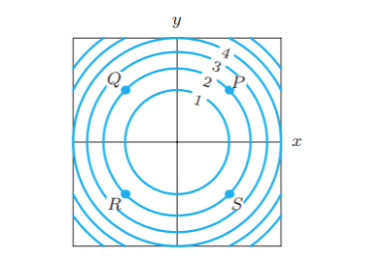
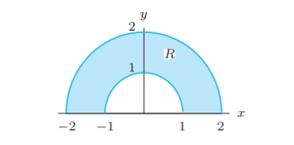

# Exam 2026

## Question 1
> Let $ f : \mathbb{R}^3 \to \mathbb{R} $ be defined by $f(x, y, z) = x^2 + y^2 + z^2$.

(a) Determine the domain and range of $f$.

(b) Describe geometrically the level set formed by $f(x, y, z) = 100$.

## Question 2
(a) Compute the following limit or show that the limit does not exist:
$$\lim_{(x,y)\to(0,0)} \frac{x + y^2}{2x + y}$$

(b) Is the following function continuous along $y = 0$?
$$f(x, y) = \begin{cases} 1 - x & y \geq 0 \\ -2 & y < 0 \end{cases}$$

## Question 3
> Let $g(x, y, z) = x^2 - 2xy^2 + az - a$.

(a) Find an equation of the tangent plane to $g$ at the point $(1, 1, 1)$.

(b) For which value of $a$ does the tangent plane pass through the origin?

## Question 4
> Below is a contour diagram of $f(x, y)$.
>  
>
> Hint: what kind of function $f(x,y)$ would produce a contour plot like the one shown? Compute its $f_x$, $f_y$, $f_{xx}$ and $f_{yy}$.

In each of the following cases, list the marked points in the diagram (there may be none or more than one) at which:

(a) $f_x < 0$
(b) $f_y > 0$
(c) $f_{xx} > 0$
(d) $f_{yy} < 0$

## Question 5
> Let $F(x) = \int_0^x \cos(\pi t)\, dt$.

(a) Evaluate $F(1)$.

(b) For what values of $x$ is $F(x)$ positive? negative?

## Question 6
> Let $$ T(x, y) = e^{-(x^2 + y^2)$$ represent the heat at the point $(x, y)$.

(a) In which direction should a heat-seeking bug move from the point $(-1, 1)$ to increase its temperature fastest?

(b) Find the directional derivative of $T$ at the point $P = (-1, 1)$ in the direction of $(1, 1)$.

(c) Does $T$ have a maximum or a minimum? At where? Hint: You don't need to compute second-order derivatives. Consider that $\exp$ is monotone increasing and how that affects the extrema of $T$.

## Question 7
> Consider the function $f(x, y) = |xy|$.

(a) Is $f$ differentiable at $(1, 0)$? Explain.

(b) Is $f$ differentiable at $(0, 0)$? Explain.

## Question 8
> 

Use polar coordinates to evaluate $\displaystyle\iint_R \sqrt{x^2 + y^2}\, dA$.

## Question 9
> Let $W = \{(x, y, z) \mid 1 \leq x^2 + y^2 \leq 4,\ 0 \leq z \leq 4\}$.

Evaluate the following integral by using cylindrical or spherical coordinates:
$$\iiint_W \frac{z}{(x^2 + y^2)^{3/2}}\, dV$$

## Question 10: True or False

- [true] If a function is differentiable, it must be continuous.
  > Differentiability at a point forces continuity there; the converse fails (e.g. $|x|$ at $0$).
- [false] $\displaystyle\int_0^1\int_0^x f(x,y)\,dy\,dx = \int_0^1\int_0^y f(x,y)\,dx\,dy$
  > Swapping the order changes the limits: the region $0 \le y \le x \le 1$ is $\int_0^1\int_y^1 f\,dx\,dy$, not $\int_0^1\int_0^y$.
- [false] If $\displaystyle\iint_R f\,dA = 0$, then $f$ is zero at all points in $R$.
  > Positive and negative parts can cancel: $f(x, y) = x$ over the square $-1 \le x \le 1$, $0 \le y \le 1$ integrates to $0$.
- [false] If $f$ and $g$ are two functions continuous on a region $R$, then $\int_R f \cdot g\, dA = \int_R f\, dA \cdot \int_R g\, dA$
  > Integrals do not multiply like this: with $f = g = 1$ on a region of area $2$, the left side is $2$ but the right side is $4$.
- [false] A local maximum of $f$ can only occur at the critical points.
  > Away from the boundary, a local maximum can only be at a critical point (where $\nabla f = \mathbf{0}$ or is undefined); but on a closed region it can also sit on the boundary, where neither need hold.
