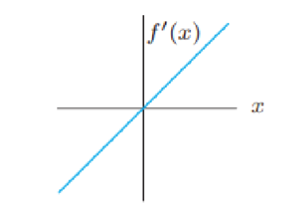
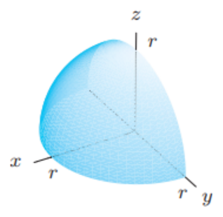
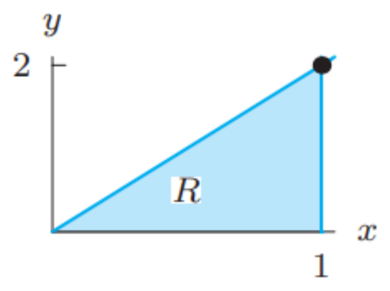

# ReExam 2026

## Question 1
> Use the following figure about $f'(x)$ to answer the questions:
> 

(a) Over what intervals is $f$ increasing? Decreasing?

(b) Does $f$ have local maximum or local minimum? If so, which and where?

### Answer
(a) $f'(x) < 0$ for $x < 0$ and $f'(x) > 0$ for $x > 0$, so $f$ is decreasing on $(-\infty, 0)$ and increasing on $(0, \infty)$.
(b) $f'$ changes sign from negative to positive at $x = 0$, so $f$ has a local minimum at $x = 0$, and no local maximum.

## Question 2
(a) Determine whether the following limit exists.
$$\lim_{(x,y)\to(0,0)} \frac{xy}{x^2 + y^2}$$

(b) Is the function continuous along $y = x$?
$$h(x, y) = \begin{cases} x^2 & y \geq x, \\ -1 & y < x. \end{cases}$$

### Answer
(a) The limit does not exist. Along $y = 0$ the expression is $0$; along $y = x$ it is $\frac{x^2}{2x^2} = \frac{1}{2}$. Two paths give two different values.
(b) No. On the line itself $h(a, a) = a^2$, but approaching $(a, a)$ from below the line, where $y < x$, gives $-1$. Since $a^2 = -1$ has no solution, $h$ is not continuous at any point of $y = x$ (even though $h$ restricted to the line, $x \mapsto x^2$, is continuous).

## Question 3
> A plane has equation $z = 5x - 2y + 7$.

(a) Find a value of $\lambda$ making the vector $(\lambda, 1, 0.5)$ normal to the plane.

(b) Find a value of $a$ so that the point $(a + 1, a, a - 1)$ lies on the plane.

### Answer
(a) Written as $5x - 2y - z = -7$, the plane has normal $(5, -2, -1)$. The vector must be a multiple $t(5, -2, -1)$: $1 = -2t$ gives $t = -\tfrac{1}{2}$, which also matches $0.5 = -t$. So $\lambda = 5t = -\tfrac{5}{2}$.
(b) Substitute the point: $a - 1 = 5(a + 1) - 2a + 7 = 3a + 12$, so $-2a = 13$ and $a = -\tfrac{13}{2}$.

## Question 4
Find the equation of the tangent plane of $z = e^y + x + x^2 + 6$ at the point $(1, 0, 9)$.

### Answer
At $(1, 0)$: $z_x = 1 + 2x = 3$ and $z_y = e^y = 1$, so
$$z = 9 + 3(x - 1) + 1 \cdot (y - 0) = 3x + y + 6.$$

## Question 5
(a) What is the rate of change of $f(x, y) = 3xy + y^2$ at the point $(2, 3)$ in the direction $(3, -1)$?

(b) What is the direction of maximum rate of change of $f$ at $(2, 3)$?

(c) What is the maximum rate of change?

### Answer
$\nabla f = (3y,\ 3x + 2y)$, so $\nabla f(2, 3) = (9, 12)$.
(a) With the unit vector $u = \tfrac{1}{\sqrt{10}}(3, -1)$: $f_u(2, 3) = \tfrac{9 \cdot 3 - 12}{\sqrt{10}} = \tfrac{15}{\sqrt{10}} \approx 4.74$.
(b) The direction of $\nabla f(2, 3) = (9, 12)$, i.e. $\tfrac{1}{5}(3, 4)$.
(c) $\|\nabla f(2, 3)\| = \sqrt{81 + 144} = 15$.

## Question 6
> We want to express the volume of the quarter sphere below as an integral of the spherical coordinate $\int_W f\,dV$ where $W$ is the quarter sphere and $dV = \rho^2 \sin(\phi)\,d\rho\,d\phi\,d\theta$.
> 

(a) (2 pts) What must the function $f$ be?

(b) (5 pts) Write the limits of the integration.

(c) (3 pts) Evaluate the integral.

### Answer
(a) $f = 1$: integrating $1$ over $W$ gives its volume.
(b) The quarter sphere lies above the $xy$-plane on the side $x \ge 0$: $0 \le \rho \le r$, $0 \le \phi \le \tfrac{\pi}{2}$, $-\tfrac{\pi}{2} \le \theta \le \tfrac{\pi}{2}$.
$$\int_{-\pi/2}^{\pi/2} \int_0^{\pi/2} \int_0^r \rho^2 \sin\phi \, d\rho \, d\phi \, d\theta$$
(c) $\pi \cdot 1 \cdot \tfrac{r^3}{3} = \tfrac{\pi r^3}{3}$, a quarter of $\tfrac{4}{3}\pi r^3$. (Any $\theta$-interval of length $\pi$ describes a congruent quarter and gives the same value.)

## Question 7
Integrate the function $f(x, y) = x + y$ over the shaded region below.

### Answer
The region is $0 \le x \le 1$, $0 \le y \le 2x$ (its top edge runs from $(0, 0)$ to $(1, 2)$).
$$\int_0^1 \int_0^{2x} (x + y)\,dy\,dx = \int_0^1 \left[xy + \tfrac{y^2}{2}\right]_0^{2x} dx = \int_0^1 4x^2\,dx = \tfrac{4}{3}$$

## Question 8
> Let $F(x) = \int_0^x \sin(\pi t)\,dt$.

(a) Evaluate $F(1)$.

(b) For what values of $x$ is $F(x)$ positive? negative?

### Answer
$F(x) = \left[-\tfrac{\cos(\pi t)}{\pi}\right]_0^x = \tfrac{1 - \cos(\pi x)}{\pi}$.
(a) $F(1) = \tfrac{1 - \cos\pi}{\pi} = \tfrac{2}{\pi}$.
(b) Since $\cos(\pi x) \le 1$, $F(x) \ge 0$ for every $x$: it is positive everywhere except at the even integers, where $F(x) = 0$, and it is never negative.

## Question 9
Find the volume of the solid that lies under the paraboloid $z = 4 - x^2 - y^2$ and above the $xy$-plane.

### Answer
The paraboloid meets the $xy$-plane on the circle $x^2 + y^2 = 4$. In polar coordinates:
$$V = \int_0^{2\pi} \int_0^2 (4 - r^2)\, r\,dr\,d\theta = 2\pi \left[2r^2 - \tfrac{r^4}{4}\right]_0^2 = 2\pi(8 - 4) = 8\pi$$

## Question 10: True or False
Decide whether the following statements are true or false.

- [false] If all partial derivatives of $f(x, y)$ exist at a point $(a, b)$, then $f$ must be continuous at $(a, b)$.
  > Partial derivatives only look along the axes. $f(x, y) = \frac{xy}{x^2 + y^2}$ with $f(0, 0) = 0$ has $f_x(0, 0) = f_y(0, 0) = 0$, yet it is not continuous at the origin (compare Question 2).
- [true] The iterated integral $\int_0^2 \int_0^{x^2} f(x, y)\,dy\,dx$ is equal to $\int_0^4 \int_{\sqrt{y}}^2 f(x, y)\,dx\,dy$.
  > Both describe the region under $y = x^2$ for $0 \le x \le 2$: for a fixed $y \in [0, 4]$, $x$ runs from $\sqrt{y}$ to $2$.
- [true] If $f(x, y)$ is a continuous function on a closed region $R$ and $f(x, y) \geq 0$ for all $(x, y)$ in $R$, then $\iint_R f(x, y)\,dA = 0$ implies that $f(x, y) = 0$ at all points in $R$.
  > If $f(p) > 0$ somewhere, continuity keeps $f$ positive on a small patch of $R$ around $p$, which adds a positive amount; with $f \ge 0$ nothing can cancel it.
- [false] For any continuous function $f(x, y)$, the double integral $\iint_R f(x, y)\,dA$ represents the volume of the solid trapped between the surface $z = f(x, y)$ and the $xy$-plane over the region $R$.
  > Only when $f \ge 0$. Where $f$ is negative, the integral counts the volume below the plane negatively.
- [false] If $\nabla f(a, b) = \mathbf{0}$, then $f$ must have a local maximum or a local minimum at $(a, b)$.
  > A critical point can be a saddle: $f(x, y) = x^2 - y^2$ has $\nabla f(0, 0) = \mathbf{0}$ but no extremum there.
