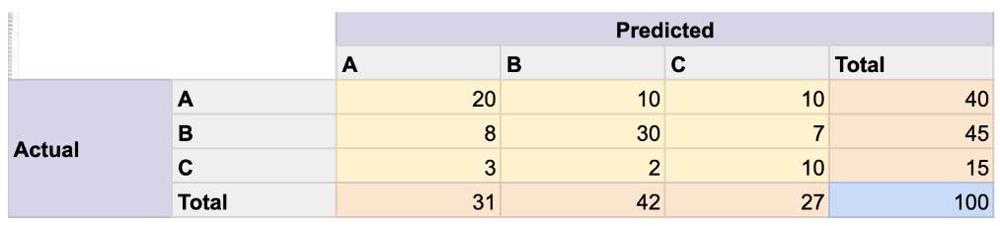

# Re-exam February 2024

## Question 1: PyTorch Training Loop
Setup: Code:
```
for epoch in range(100):
    for inputs_batch, outputs_batch in train_dl:
        predictions_batch = model(inputs_batch.view(-1, 784))
        loss = loss_function(predictions_batch, outputs_batch)
        loss.backward()
        optimizer.step()
        optimizer.zero_grad()
```

- [false] The code performs gradient-descent updates 100 times
- [false] The code will give a dimensionality mismatch error regardless of the minibatch size because the "inputs_batch" tensor is transformed into an invalid size by the "view(-1, 784)" operation
- [false] The code implements the training stage of a supervised learning task
- [false] Line 6 updates the model parameters
- [false] Line 5 computes the gradients of the loss function for the drawn minibatch

## Question 2: PyTorch nn.Sequential
Setup: Code:
```
model = nn.Sequential(
  nn.Linear(10, 100),
  nn.ReLU(),
  nn.Linear(100, 250),
  nn.ReLU(),
  nn.Linear(250, 125),
  nn.ReLU(),
  nn.Linear(125, 2)
)
```

- [false] The neural network uses the hyperbolic tangent activation function in all layers
- [false] Line 4 should be replaced by nn.Linear(250, 100) for the source code to run without a dimensionality mismatch error
- [false] The code will run without a dimensionality mismatch error only on minibatches of 10 observations
- [false] The "forward" function of the created neural network object returns a 125-dimensional output vector
- [false] The source code implements a neural network architecture for 10-dimensional input observations

## Question 3: kNN Classifier
Setup: You are given a k-Nearest-Neighbor (kNN) classifier evaluated on a particular training and test split of a particular data set for a particular choice of k. Evaluate the following statements related to this classifier.

- [false] The kNN classifier's estimator variance gets smaller as the training set size gets smaller
- [false] The kNN classifier's test accuracy is guaranteed to increase by reducing $k$
- [false] The kNN classifier's prediction error on the training set may be larger than its prediction error on the test set in some data sets
- [false] The kNN classifier's underfitting risk is mitigated by increasing training data size
- [false] The kNN classifier's overfitting risk is mitigated by increasing $k$

## Question 4: Discrete Random Variable $X$
Setup: $P(X=1)=0.2, \quad P(X=2)=0.5, \quad P(X=3)=0.3$.

- [false] The variance of the random variable $X$ is smaller than 0
- [false] The mean of the random variable $X$ is greater than 2
- [false] $P(X < 3) = 0.7$
- [false] $P(X < 4) < 1$
- [false] $P(X \text{ is odd}) = P(X \text{ is even})

## Question 5: Two Independent Random Variables
Setup: 
 $\mathbb{E}[X_1]=\mu_1$, $\mathbb{E}[X_2]=\mu_2$, $\text{Var}[X_1]=\sigma_1^2$, $\text{Var}[X_2]=\sigma_2^2$. $X_1, X_2$ are independent.

- [false] $\mathbb{E}[aX_1 + bX_2] = (a+b)(\mathbb{E}[X_1] + \mathbb{E}[X_2])$.
- [false] $\text{Var}[c(X_1+X_2)] = c^2\text{Var}[X_1] + c^2\text{Var}[X_2]$.
- [false] $\mathbb{E}[X_1^2 + X_2^2] = \mu_1^2 + \mu_2^2 + \sigma_1^2 + \sigma_2^2$.
- [false] $\text{Var}[X_1 \cdot X_2] = \text{Var}[X_1] \cdot \text{Var}[X_2]$.
- [false] $\text{Var}[X_2^2] = \text{Var}[X_2]^2$.

## Question 6: Events $A$, $B$ and $C$
Setup: A and C independent. B and C independent. A and B disjoint.
$P(A \cup B) = x$, $P(B \cup C) = y$, $P(A \cup B \cup C) = z$, for $x,y,z \in [0,1]$.

- [false] $P(B) = x + y - z$
- [false] $P(A) = \frac{z-x}{1-(x+y-z)}$
- [false] If $x = y$ then $P(A) = P(C)$
- [false] $z - x - y + 1 \geq 0$
- [false] $y > z$

## Question 7: Fair Coin Tossed Four Times
A fair coin is tossed four times. The event that one side of the coin shows upwards when the coin is at rest is denoted as "heads" and the other side as "tails". The coin tosses are independent and identically distributed events. In other words, the outcomes of the previous tosses do not have any effect on the outcome of the next one. Evaluate the following statements regarding this coin toss experiment.

- [false] Probability of at least two heads is equal to the probability of at least two tails
- [false] The expected value of the number of heads is 1/2
- [false] Probability of four tails is 1/16
- [false] Probability of at least one heads is less than the probability of at least two heads
- [false] "The number of heads being odd" and "getting two or fewer heads" are independent events

## Question 8: Q-Learning Algorithm
Evaluate the following statements about the Q-learning algorithm.

- [false] Q-learning is an unsupervised learning algorithm
- [false] Q-learning assumes that the reward of a state transition resulting from a taken action is observed
- [false] The output of Q-learning run on an episodic environment is a function mapping a state-action pair to an estimate of the sum of discounted rewards until the end of the episode
- [false] Q-learning assumes that the exact state transition distribution is available
- [false] Q-learning iterations are guaranteed to converge only if the agent's actions do not affect the environment state

## Question 9: Confusion Matrix
Setup: 
 Consider the confusion matrix below obtained from a classifier evaluated on the test split of a data set comprising data points with discrete labels that can take three possible values: A, B, C. Each of these values correspond to a class. 
  
 Evaluate the below statements regarding this confusion matrix.

- [false] Precision for Class A is smaller than recall for Class A.
- [false] Precision for Class B is smaller than recall for Class B.
- [false] Precision for Class C is smaller than recall for Class C.
- [false] The random classifier that predicts each of the three classes with equal probability has an expected accuracy of 50% on this test split.
- [false] The accuracy of a classifier that always predicts Class B on this test split is higher than the expected accuracy of a random classifier predicting each of the three classes with equal probability.

## Question 10: k-Means
Setup: $D = \{(1,1),(2,2),(3,1),(4,4),(5,4),(5,5)\}$, 
 k=2, Euclidean distance, ties broken in favor of Cluster 1.
Option 1 init: $\mu_1=(3,3)$, $\mu_2=(3,4)$. Option 2 init: $\mu_1=(2,2)$, $\mu_2=(3,1)$.

- [false] When initialized with Option 2, the algorithm converges after the centroids are updated only once
- [false] When initialized with Option 1, the points (1,1),(2,2),(3,1) are assigned to Cluster 1 and (4,4),(5,4),(5,5) to Cluster 2
- [false] When initializated with Option 1, the algorithm converges after the centroids are updated only once
- [false] The two initialization options converge to different clustering results
- [false] When initialized with Option 2, the points (1,1),(2,2),(3,1) are assigned to Cluster 1 and (4,4),(5,4),(5,5) to Cluster 2

## Question 11: Coins
Setup: Three coins. Two are fair, one is unfair with Heads probability 3/4. 
 $U$ = which coin is unfair,
$P(U=1)=P(U=2)=P(U=3)=1/3$ a priori. 
 First two coins observed Heads, third Tails: outcome HHT.

- [false] $P(U=1|HTH) < P(U=1|HHT)$
- [false] $P(U=2|HHT) > P(U=2)$
- [false] $P(U=1|HHT) > P(U=1)$
- [false] $P(U=3|HHT) > P(U=3)$
- [false] $P(U=2|HHT)$ would not change if $P(U=2)$ were equal to 2/3
