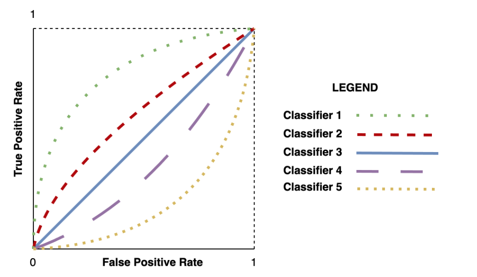
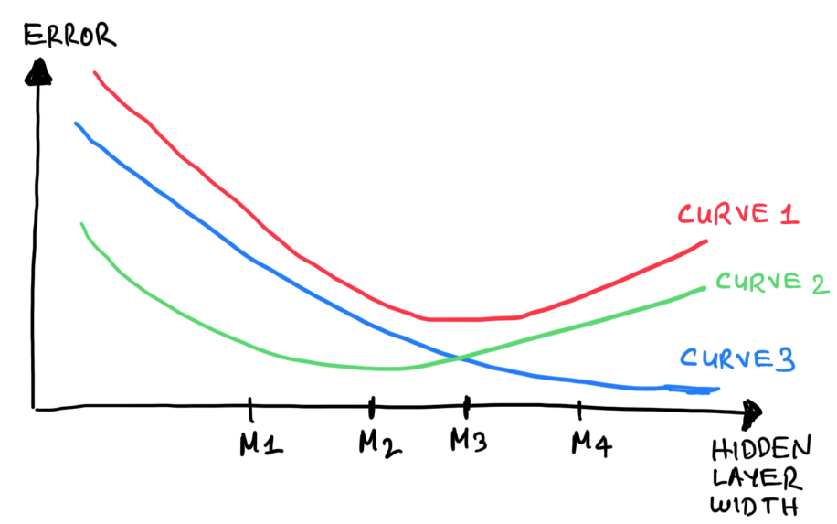
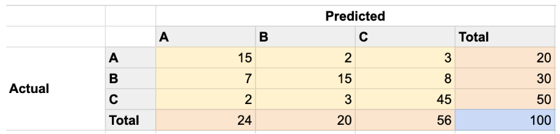

# Exam January 2024

## Question 1: ROC Curves
Setup: Five binary classifiers have ROC curves as given in the figure below.

Definitions: outperform = more favorable ROC curve; random classifier = max-entropy predictions;
negating the predictions = flipping all predicted labels; perfect classifier = 100% accuracy.

- [false] Classifier 2 outperforms a random classifier.
- [false] The area under the ROC curve of a perfect classifier depends on the ratio of the positive and negative labels in the data set used to draw the ROC curve.
- [false] Classifier 5 outperforms Classifier 4 if the predictions of both classifiers are negated.
- [false] A random classifier outperforms Classifier 4 if the predictions of both classifiers are negated.
- [false] Classifier 1 outperforms Classifier 2 if the predictions of both classifiers are negated.

## Question 2: Neural Network Exact Representation
Setup: A network maps scalar input $x$ to a hidden layer $(z_1,\dots,z_K)$ with $z_j = w_j x + b_j$,
applies a step activation $h_j = 1$ if $z_j > 0$ else $0$, then linearly combines $(h_1,\dots,h_K)$
into a scalar output $y$. Can this network exactly represent each function type below

- [no] Polynomials of degree one: $y = ax + b$.
- [no] Polynomials of degree two: $y = ax^2 + bx + c$.
- [no] Piecewise constant functions: $y = \begin{cases} c_1, & \text{if } x < a_1 \\ c_2, & \text{if } a_1 \leq x < a_2 \\ \vdots \\ c_K, & \text{if } x \geq a_K \end{cases}$ for constants $c_1, \dots, c_K$ and thresholds $a_1, \dots, a_K$
- [no] Hinge loss: $y = \max(1-x, 0)$.
- [no] The logistic sigmoid function: $y = \frac{1}{1+e^{-x}}$.

## Question 3: kNN Variance Reduction
Setup: A kNN classifier is evaluated on a particular training/test split for a particular choice of k.
Which actions are GUARANTEED to reduce the classifier's variance

- [false] Allocating a larger portion of the data set for training.
- [false] Building a majority voting ensemble of three kNN classifiers.
- [false] Increasing k.
- [false] Normalizing the input features.
- [false] Enlarging the test split by collecting new data.

## Question 4: k-Means Clustering

- [false] Two different initializations of k-means always converge to the same partitioning if the cluster count k is greater than two.
- [false] k-means always finds an optimal partitioning after a finite number of iterations according to an objective optimality criterion.
- [false] For a fixed input dimensionality, the size of the memory k-means requires during the computation of one iteration is smaller than the memory the Expectation Maximization (EM) algorithm requires during the computation of one iteration.
- [false] k-means always converges to a partitioning after a finite number of iterations.
- [false] For a fixed input dimensionality and fixed hardware configuration, the computation time k-means requires for completing one iteration is less than the computation time the Expectation Maximization (EM) algorithm requires for completing one iteration.

## Question 5: PyTorch Training Loop (epoch range 100)
Setup: Code:
```
for epoch in range(100):
    for inputs_batch, outputs_batch in train_dl:
        predictions_batch = model(inputs_batch.view(-1, 784))
        loss = loss_function(predictions_batch, outputs_batch)
        loss.backward()
        optimizer.step()
        optimizer.zero_grad()
```

- [false] The code implements the K-fold cross-validation stage of a supervised learning task.
- [false] Line 5 updates the model parameters.
- [false] The code implements the training stage of a supervised learning task.
- [false] The code performs iterative optimization using stochastic gradient descent.
- [false] Line 7 computes the gradients of the loss function for the drawn minibatch.

## Question 6: PyTorch nn.Sequential Architecture
Setup: Code:
```
model = nn.Sequential(
  nn.Linear(10, 100),
  nn.ReLU(),
  nn.Linear(100, 250),
  nn.ReLU(),
  nn.Linear(250, 125),
  nn.ReLU(),
  nn.Linear(125, 2)
)
```

- [false] The neural network has more than 50000 parameters.
- [false] The neural network has three hidden layers.
- [false] The code will run without a dimensionality mismatch error only for 100-dimensional input observations.
- [false] The code will run without a dimensionality mismatch error only on minibatches of 100 observations.
- [false] Line 6 should be replaced by nn.Linear(125, 250) for the code to run without a dimensionality mismatch error.

## Question 7: Training/Generalization Error Curves
Setup: Two of the three curves shown below depict how the training and generalization error of a neural network with two fully connected layers changes as hidden layers get wider according to the assumptions of the statistical learning theory. The remaining curve does not have a meaning and needs to be discarded.


- [false] Curve 3 (blue) depicts the training error.
- [false] Choosing the hidden layer width smaller than M3 causes underfitting.
- [false] The model with optimal generalization performance is M2.
- [false] Model M4 underfits more than model M1.
- [false] Curve 2 (green) depicts the generalization error.

## Question 8: Fair Coin Tossed Three Times

- [false] Observing an even number of heads and observing exactly two heads are equally probable events.
- [false] Observing an odd number of heads and observing less than two heads are independent events.
- [false] The probability of three heads is 1/8.
- [false] The probability of observing exactly one heads is 3/8.
- [false] Given that you have observed at least one heads, the probability that you observe at least two heads is smaller than 1/2.

## Question 9: Covariance of Two Independent Random Variables
Setup: $\mathbb{E}[A]=\alpha$, $\text{Var}(A)=\beta$, $\mathbb{E}[B]=\gamma$, $\text{Var}(B)=\phi$. A and B are independent.

- [false] $\mathbb{E}[A + cB] = \alpha + c\gamma$.
- [false] $\mathbb{E}[A^2] = \alpha^2 + \beta$.
- [false] $\text{Var}(cA) = c\beta$ for a positive constant $c$.
- [false] $\text{Cov}(A, B)$ cannot be inferred from the information given in the question text.
- [false] $\text{Var}(AB) \geq \beta\phi$.

## Question 10: Confusion Matrix (A/B/C, 100 samples v2)
Consider the confusion matrix below obtained from a classifier evaluated on the test split of a data set comprising data points with discrete labels that can take three possible values: A, B, C. Each of these values correspond to a class.


- [false] The accuracy of a classifier that always predicts Class C is higher than the expected accuracy of a random classifier that predicts each class with equal probability.
- [false] The precision for Class B is 0.75.
- [false] The precision for Class A is greater than the recall for Class A.
- [false] A random classifier that predicts each of the three classes with equal probability has an expected accuracy of 50% on this test split.
- [false] False positive rate for the Class B is smaller than the precision

## Question 11: Bernoulli Data Set
Setup: $X_1, X_2, X_3, X_4$ iid Bernoulli($\pi$). 
 Observed data: $D = \{X_1=1, X_2=0, X_3=1, X_4=1\}$.

- [false] Performing Bayesian inference on $\pi$ with respect to data set $D$ using a prior distribution $\text{Beta}(\pi|\alpha, \beta)$ yields the posterior distribution $\text{Beta}(\pi|\alpha + 3, \beta + 1)$.
- [false] The maximum likelihood estimate for $\pi$ is 0.75.
- [false] The maximum likelihood estimate for $\pi$ cannot be guaranteed to converge to the true $\pi$ as the size of the data set $D$ grows without making additional assumptions about the model.
- [false] If $\pi = 0.3$ then $P(X_1+X_2+X_3+X_4 < 3) \geq 0.67$.
- [false] $P(X_1=A, X_2=B|\pi) = P(X_1=A|\pi)P(X_2=B|\pi)$ for any binary pair of values A, B.

## Question 12: Markov Property Sequence
Setup: $X_1, X_2, X_3, X_4$ satisfy the Markov property, subscripts denote time order.

- [false] $X_2$ and $X_4$ do not have to be independent if $X_1$ is observed.
- [false] $X_1$ and $X_3$ have to be independent if $X_2$ is observed.
- [false] $X_1$ and $X_4$ have to be independent if $X_3$ is observed.
- [false] $X_2$ and $X_3$ have to be independent random variables.
- [false] $X_3$ and $X_4$ have to be independent if $X_2$ is observed.

## Question 13: Events A, B, C (Independence/Disjoint)
Setup: A and C are independent. B and C are independent. A and B are disjoint.
$P(A \cup C) = 2/3$, $P(B \cup C) = 3/4$, $P(A \cup B \cup C) = 11/12$.

- [false] $P(C) = P(B)$.
- [false] $P(A) < P(B)$.
- [false] $P(A \cap C) = \emptyset$.
- [false] $P(A) + P(B) > P(A \cup B)$.
- [false] $P(B) = 1/2$.
