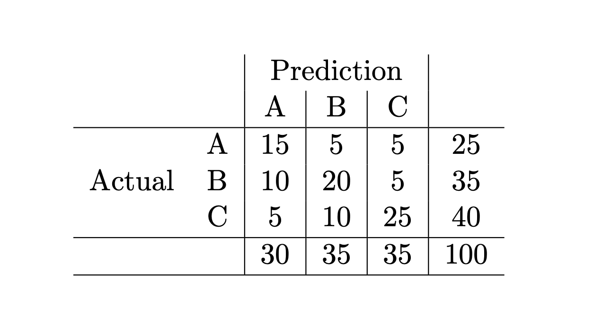
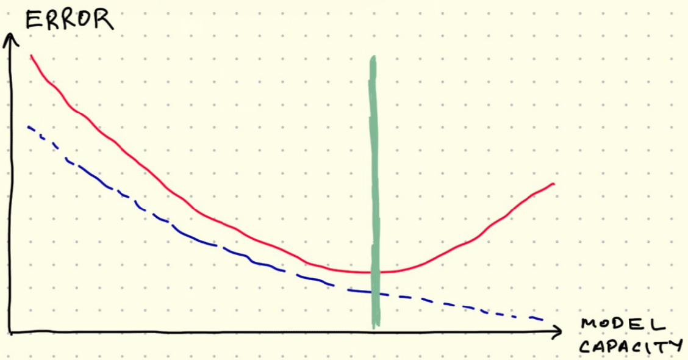

# Exam January 2025

## Question 1: Ridge Regression Bias-Variance
Setup: 
 Ridge regression loss $$ L(w) = \frac{1}{n}\sum_{i=1}^n (y_i - w^\top x_i)^2 + \alpha||w||_2^2 $$
fit on $D = \{(x_i,y_i)\}$, $\alpha > 0$. Model variance is defined w.r.t. experiment repetitions.

- [false] Model bias increases as $n$ increases.
- [false] Model variance increases as $\alpha$ increases.
- [true] The overfitting risk of the model reduces as $\alpha$ increases.
- [false] Model capacity increases as $\alpha$ increases.
- [true] The underfitting risk of the model reduces as $\alpha$ decreases.

## Question 2: Confusion Matrix
Setup: 
  
 Evaluate the below statements regarding this confusion matrix.

- [false] The precision for Class A is greater than the recall of Class A.
- [true] The precision for Class B is equal to the recall of Class B.
- [true] The precision for Class C is greater than the recall of Class C.
- [true] The recall for Class A is greater than the recall for Class B.
- [false] The accuracy of the classifier is smaller than 0.5.

## Question 3: Coins
Setup: 
 $C$ = number of heads in three tosses of a coin with heads probability 2/3.

- [false] $P(C=1) > P(C=3)$.?
- [false] $\mathbb{E}[C] > 2$.?
- [true] $\mathbb{E}[C^2] > \mathbb{E}[C]^2$.
- [true] $P(C=0) < P(C=3)$.
- [true] $\mathbb{E}[C^2] > \text{Var}[C]$.

## Question 4: Bias-Variance Curve (Model Capacity)
Setup: 
  
 Evaluate the following statements about the figure above.

- [true] The solid red line shows the model prediction error on the test split.
- [true] The dashed blue line shows the model prediction error on the training split.
- [false] The right-hand side of the solid vertical green line indicates the underfitting region.
- [true] The optimal model capacity is marked by the green line.
- [false] Doubling the size of the training data without changing the size of the test data would shift the vertical green line to the left.

## Question 5: Events A and B
Setup: 
 $A$ and $B$ are events with $0 < P(A) < 1$ and $0 < P(B) < 1$.

- [true] If A and B are disjoint, they cannot be independent.
- [true] If A and B are independent, they cannot be disjoint.
- [false] If $A \subset B$, then it is possible that A and B are independent.
- [false] If A and B are independent, then it is possible that A and $A \cup B$ are independent.
- [true] There exists A and B that satisfy $P(A \cup B) = 1$.

## Question 6: k-Means Clustering Algorithm
Setup: 
 Evaluate the following statements about the k−means clustering algorithm

- [false] The algorithm always converges to the same cluster centroids regardless of its initialization.
- [false] The algorithm can never converge to a clustering before changing the assignment of at least one data point at least once after initialization.
- [false] The computational complexity of the algorithm is not dependent on the data dimensionality.
- [true] The algorithm assigns each data point to a single cluster.
- [true] The algorithm cannot output spiral-shaped clusters when k > 1 and the algorithm is run until convergence starting from a random initialization.

## Question 7: ReLU Predictor
Setup: 
 $f(x) = W_2^\top \max(W_1^\top x, 0)$ for $W_1 \in \mathbb{R}^{d\times h}$, $W_2 \in \mathbb{R}^{h\times 1}$,
max applied element-wise.

- [false] The predictor can reach zero training error only if the input-output relationship is perfectly linear, i.e. $\exists \beta \in \mathbb{R}^d$ s.t. $y_i = \beta^\top x_i$ for all training inputs/labels.
- [true] The predictor corresponds to a neural network with a single hidden layer of size $h$.
- [true] The predictor corresponds to a neural network that uses a rectified linear unit as its activation function.?
- [false] The predictor cannot map an input outside the $[0,1]$ interval no matter which values $W_1$ and $W_2$ take.
- [false] The gradient descent algorithm is guaranteed to converge to the global minimum of the loss function $(y-f(x))^2$ if the learning rate is chosen small enough.

## Question 8: Bernoulli Data Set
Setup: 
 $$ D = \{X_i : i=1,\dots,n\}, X_i \overset{\text{iid}}{\sim} \text{Bernoulli}(\pi) $$.

- [true] The maximum likelihood estimate for $\pi$ is $\frac{1}{n}\sum_{i=1}^n X_i$.
- [true] $\mathbb{E}[X_i] = \mathbb{E}[X_j]$ for all $i \neq j$.
- [false] $\text{Var}[X_i] > 1$.
- [true] If $D = \{0,1,1,0,1\}$, then the likelihood of $\pi$ is $\pi^3(1-\pi)^2$.
- [false] $P(X_i=1 \cup X_j=0) > P(X_i=1) + P(X_j=0)$.

## Question 9: Train Paris to Berlin
Setup: 
 Train takes northern route (via Brussels) 60% of the time, southern route (via Strasbourg) 40%.
Arrives late 30% of the time on the northern route, 10% of the time on the southern route.

- [true] Observing that the train is late increases the probability that it took the northern route.
- [false] Observing that the train is late increases the probability that it took the southern route.
- [true] If the train chose the northern and southern route with equal percentages, then $P(\text{northern}|\text{late}) > P(\text{southern}|\text{late})$.
- [false] If the train is observed to arrive Berlin late, then the probability that it took the northern route is smaller than the probability that it took the southern route.
- [false] The probability that the train will arrive Berlin late is greater than the probability that it will arrive Berlin late given that it took the northern route.

## Question 10: k-Nearest Neighbor Classifier
Setup: 
 Assume all conditions other than those specified in each statement are equal. 
 $k$ denotes the number of nearest neighbors used for classification.

- [false] Model bias increases if the training set size grows.
- [false] Model variance increases if $k$ grows.
- [true] The model has higher overfitting risk if training set size shrinks.
- [true] The underfitting risk of the model increases if $k$ grows.
- [false] The training error is guaranteed to be zero for all $k > 0$.

## Question 11: PyTorch Training Loop
Setup: Code:
```
for epoch in range(20):
    for inputs_batch, outputs_batch in train_dl:
        predictions_batch = model(inputs_batch.view(-1, 5))
        loss = ((predictions_batch - outputs_batch) ** 2).mean()
        loss.backward()
        optimizer.step()
        optimizer.zero_grad()
```

- [true] The code is usable for the training stage of a regression task.
- [true] The input dimensionality is five.
- [false] The command optimizer.step() updates the gradients of the model parameters.
- [false] The command loss.backward() updates the learnable parameters of the model.
- [true] The code uses each data point within the set train_dl exactly 20 times for training.

## Question 12: PyTorch nn.Sequential
Setup: Code:
```
model = nn.Sequential(
  nn.Linear(100, 500),
  nn.ReLU(),
  nn.Linear(500, 5),
  nn.Softmax()
)
```

- [false] The code builds a neural network with a single hidden layer containing 100 neurons.
- [true] The model assumes that the input data points have 100 features.
- [true] The model is designed to solve a classification task with 5 classes.
- [false] The model has more than 100000 parameters.
- [false] The model uses the sigmoid activation function between the hidden layer and the output layer.
