# Exam 2025

## Question 1:
Which of the following answers is correct for the recurrence? $$T(n) = 2 \cdot T(n/4) + n^2$$

- [ ] $T(n) = \Theta(1)$
- [ ] $T(n) = \Theta(\log n)$
- [ ] $T(n) = \Theta(n^{\log_4 3})$
- [ ] $T(n) = \Theta(n)$
- [ ] $T(n) = \Theta(n \log n)$
- [ ] $T(n) = \Theta(n^{\log_3 4})$
- [x] $T(n) = \Theta(n^2)$
- [ ] $T(n) = \Theta(n^2 \log n)$
- [ ] $T(n) = \Theta(n^3)$
- [ ] Cannot be solved using the Master Theorem from Cormen et al., 4th edition

## Question 2:
Which of the following answers is correct for the recurrence? $$T(n) = 4 \cdot T(n/2) + n^2$$

- [ ] $T(n) = \Theta(1)$
- [ ] $T(n) = \Theta(\log n)$
- [ ] $T(n) = \Theta(n^{\log_4 3})$
- [ ] $T(n) = \Theta(n)$
- [ ] $T(n) = \Theta(n \log n)$
- [ ] $T(n) = \Theta(n^{\log_3 4})$
- [ ] $T(n) = \Theta(n^2)$
- [x] $T(n) = \Theta(n^2 \log n)$
- [ ] $T(n) = \Theta(n^3)$
- [ ] Cannot be solved using the Master Theorem from Cormen et al., 4th edition

## Question 3:
Which of the following answers is correct for the recurrence? $$T(n) = 4 \cdot T(n/3) + n$$

- [ ] $T(n) = \Theta(1)$
- [ ] $T(n) = \Theta(\log n)$
- [ ] $T(n) = \Theta(n^{\log_4 3})$
- [ ] $T(n) = \Theta(n)$
- [ ] $T(n) = \Theta(n \log n)$
- [x] $T(n) = \Theta(n^{\log_3 4})$
- [ ] $T(n) = \Theta(n^2)$
- [ ] $T(n) = \Theta(n^2 \log n)$
- [ ] $T(n) = \Theta(n^3)$
- [ ] Cannot be solved using the Master Theorem from Cormen et al., 4th edition

## Question 4:
Which of the following answers is correct for the recurrence? $$T(n) = T(n/4) + 1$$

- [ ] $T(n) = \Theta(1)$
- [x] $T(n) = \Theta(\log n)$
- [ ] $T(n) = \Theta(n^{\log_4 3})$
- [ ] $T(n) = \Theta(n)$
- [ ] $T(n) = \Theta(n \log n)$
- [ ] $T(n) = \Theta(n^{\log_3 4})$
- [ ] $T(n) = \Theta(n^2)$
- [ ] $T(n) = \Theta(n^2 \log n)$
- [ ] $T(n) = \Theta(n^3)$
- [ ] Cannot be solved using the Master Theorem from Cormen et al., 4th edition

## Question 5:
Which of the following statements are true? [One or more correct answers.]

- [false] $3n^4$ is $\mathcal{O}(4n^3)$
- [true] $4n$ is $\mathcal{O}(n/3)$
- [false] $\sqrt{n}$ is $\mathcal{O}(\log n)$
- [false] $n^2/2 + n^3/3$ is $\mathcal{O}(2n)$
- [true] $n \log n$ is $\mathcal{O}(n^2/(\log n)^2)$
- [true] $n^{10}$ is $\mathcal{O}(10^n)$
- [true] $\log_4 n$ is $\mathcal{O}(\log_3 n)$

## Question 6:
Which of the following statements are true? [One or more correct answers.]

- [true] $2^n$ is $\Omega(n^4)$
- [true] $n^3$ is $o(n^6/2)$
- [false] $n^2$ is $\omega(n^2)$
- [false] $n^3/(\log n)^3$ is $\Theta(n^2/(\log n)^2)$
- [true] $\log n$ is $\Omega(1)$
- [false] $2$ is $o(1)$
- [true] $n - 100$ is $\Theta(n + 100)$

## Question 7:
> Build a min-heap by executing BUILD-MIN-HEAP$(A, 8)$ on the following array $A$: 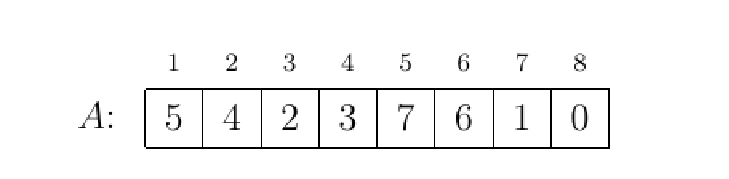

At which position in $A$ is the key 5 located afterwards?

- [ ] 1
- [ ] 2
- [ ] 3
- [ ] 4
- [ ] 5
- [ ] 6
- [ ] 7
- [x] 8

## Question 8:
An array $A$ 
  
 contains the following six keys in some order: $\{5, 6, 7, 8, 9, 10\}$.

It is given that $A$ is a min-heap. State all positions in $A$ that can hold the key 9. [One or more correct answers.]

- [incorrect] Position 1
- [incorrect] Position 2
- [correct] Position 3
- [correct] Position 4
- [correct] Position 5
- [correct] Position 6

## Question 9:
For a function $h_1(x)$: 
 $\begin{aligned}h_1 (44) &= 2 \\ h_1 (55) &= 5 \\ h_1 (66) &= 1 \\ h_1 (77) &= 2 \\ h_1 (88) &= 5 \\ h_1 (99) &= 6\end{aligned}$  
We consider a hash table $H$ of length seven using linear probing with $h_1(x)$ as the auxiliary hash function. Starting from an empty table, the keys $\{44, 55, 66, 77, 88, 99\}$ were inserted in some order. The result is: 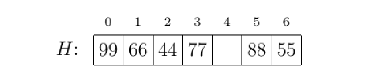

Which keys could have been inserted last (i.e. could have been last in the insertion order)? [One or more correct answers.]

- [incorrect] 44
- [incorrect] 55
- [correct] 66
- [correct] 77
- [incorrect] 88
- [correct] 99

## Question 10:
We consider a hash table $H$ of length seven using double hashing with auxiliary hash functions $h_1(x)$ and $h_2(x)$. The table currently looks like: 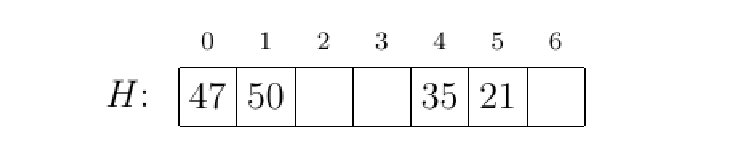 

Then key 99 is inserted, after which the table looks like: 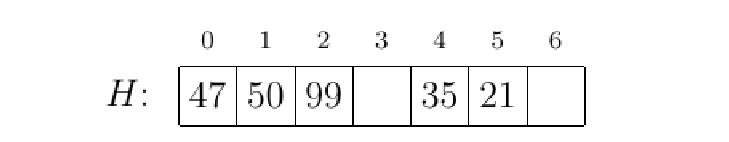

If $h_2(99) = 2$, which of the following values of $h_1(99)$ are possible? [One or more correct answers.]

- [correct] $h_1(99) = 0$
- [incorrect] $h_1(99) = 1$
- [correct] $h_1(99) = 2$
- [incorrect] $h_1(99) = 3$
- [incorrect] $h_1(99) = 4$
- [correct] $h_1(99) = 5$
- [incorrect] $h_1(99) = 6$

## Question 11:
> Execute PARTITION$(A, 1, 9)$ on the following array: 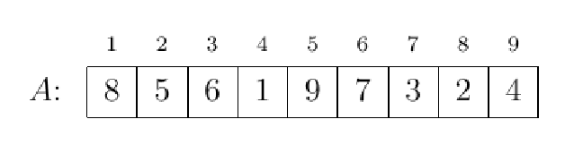

Which of the following shows the state of $A$ afterwards?

- [ ] 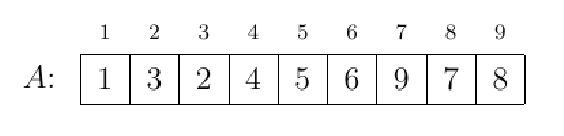
- [ ] 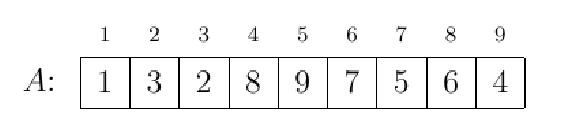
- [ ] 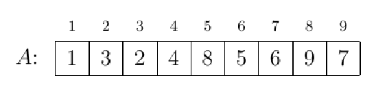
- [x] 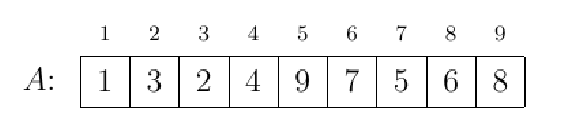
- [ ] 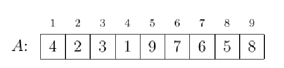
- [ ] 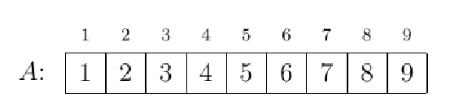

## Question 12:
An array $A$ of length nine contains the numbers $\{1, 2, 3, 4, 5, 6, 7, 8, 9\}$ in some order. After executing PARTITION$(A, 1, 9)$, $A$ looks like: 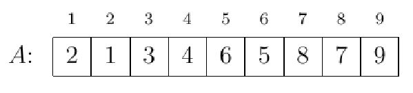

Which of the following numbers could have been the pivot element in PARTITION, i.e. could have been at the last position in $A$ at the start of the algorithm? [One or more correct answers.]

- [incorrect] 1
- [incorrect] 2
- [correct] 3
- [correct] 4
- [incorrect] 5
- [incorrect] 6
- [incorrect] 7
- [incorrect] 8
- [correct] 9

## Question 13:
> A file contains the following characters with the given frequencies: 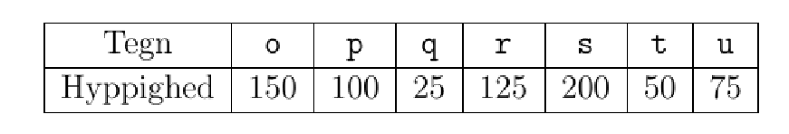

Build a Huffman tree on this input. How many bits are in the codeword for q?

- [ ] 1
- [ ] 2
- [ ] 3
- [x] 4
- [ ] 5
- [ ] 6

## Question 14:
> We still consider a Huffman tree for a file with the following frequencies: 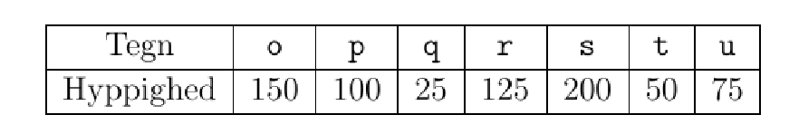

There are $150 + 100 + 25 + 125 + 200 + 50 + 75 = 725$ characters in the file. How many bits do these 725 characters occupy in total when encoded with Huffman codes?

- [ ] 1800
- [ ] 1825
- [x] 1900
- [ ] 1925
- [ ] 2000
- [ ] 2075
- [ ] 2100

## Question 15:
> Execute breadth-first search BFS$(G, a)$ on the graph $G$ below starting at node $a$: 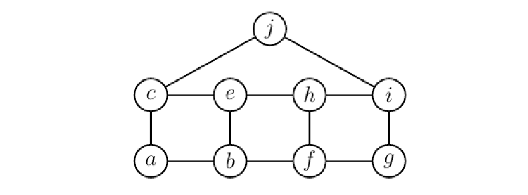
>
> For BFS the execution depends on the ordering of each node's adjacency list. Assume that each node's adjacency list is sorted in alphabetical order by the neighbours' names.

Which node is the *last* to be assigned $d$-value 3?

- [ ] $e$
- [ ] $f$
- [ ] $g$
- [ ] $h$
- [x] $i$
- [ ] $j$

## Question 16:
> Execute depth-first search DFS-VISIT$(G, a)$ on the directed graph $G$ below starting at node $a$. Read the next question before executing the algorithm: 
>
> For DFS the execution depends on the ordering of each node's adjacency list. Assume that each node's adjacency list is sorted in alphabetical order by the neighbours' names.

Which node is the last to be discovered (i.e. has the highest discovery time)?

- [ ] $b$
- [ ] $c$
- [ ] $d$
- [ ] $e$
- [ ] $f$
- [ ] $g$
- [ ] $h$
- [ ] $i$
- [x] $j$

## Question 17:
> We still consider depth-first search DFS-VISIT$(G, a)$ on the directed graph $G$ starting at node $a$ (see previous question): 

How many cross edges are found in the graph during this search?

- [x] 0
- [ ] 1
- [ ] 2
- [ ] 3
- [ ] 4
- [ ] 5
- [ ] 6

## Question 18:
Which of the following lists give a topological sorting of the graph below? 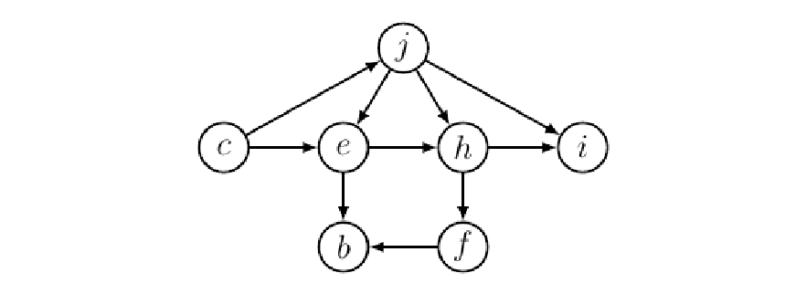 [One or more correct answers.]

- [correct] $c, j, e, h, i, f, b$
- [incorrect] $c, e, h, i, f, b, j$
- [incorrect] $b, c, e, f, h, i, j$
- [incorrect] $j, e, h, i, f, b, c$
- [correct] $c, j, e, h, f, i, b$
- [incorrect] $c, j, e, h, i, b, f$

## Question 19:
> Below is an array of eleven integers with values between 0 and 5 (inclusive): 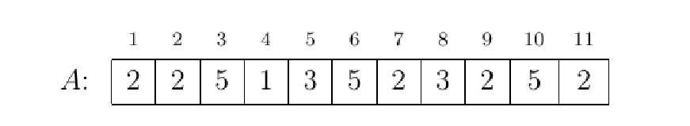
>
> We sort the numbers by executing COUNTING-SORT$(A, 11, 5)$. The algorithm uses an array $C$ with six slots (indexed 0 to 5), each holding an integer counter.

What is the sum of these six integers in $C$ at the end of the algorithm?

- [ ] 0
- [ ] 5
- [x] 11
- [ ] 18
- [ ] 23
- [ ] 32
- [ ] 34

## Question 20:
> We want to use $\text{RADIX-SORT}(A, 4)$ to sort six integers in ascending order in array $A$. [Notation from Cormen et al., 4th edition: $\text{RADIX-SORT}(A, 6, 4)$.]
>
>  [image assets/radixSort.png]

What is the content of $A$ after executing *two* of the four iterations in $\text{RADIX-SORT}(A, 4)$?

- [x] [image assets/rad1.png]
- [ ] [image assets/rad2.png]
- [ ] [image assets/rad3.png]
- [ ] [image assets/rad4.png]
- [ ] [image assets/rad5.png]

## Question 21:
> Use Kruskal's algorithm to find a minimum spanning tree (MST) for the following graph. Also read the next question before executing the algorithm: 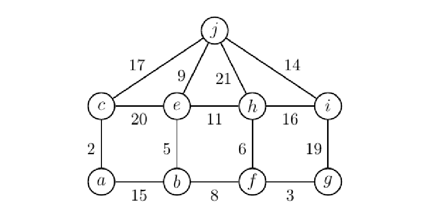

Which edge is the last to be added to the MST?

- [x] $(a, b)$
- [ ] $(i, j)$
- [ ] $(h, j)$
- [ ] $(e, h)$
- [ ] $(h, i)$
- [ ] $(e, j)$

## Question 22:
> We still consider Kruskal's algorithm on the following graph (see previous question): 
>
> We look at the first point in the algorithm where an examined edge is NOT added to the MST. How many connected components does the graph $(V, A)$ have at that point? [Here $V$ is the set of nodes in graph $G$, and $A$ is the set of edges added to the MST so far.]

How many connected components does $(V, A)$ have at that point?

- [ ] 1
- [ ] 2
- [ ] 3
- [ ] 4
- [x] 5
- [ ] 6

## Question 23:
Which of these algorithms can be used to find shortest paths on the following graph? 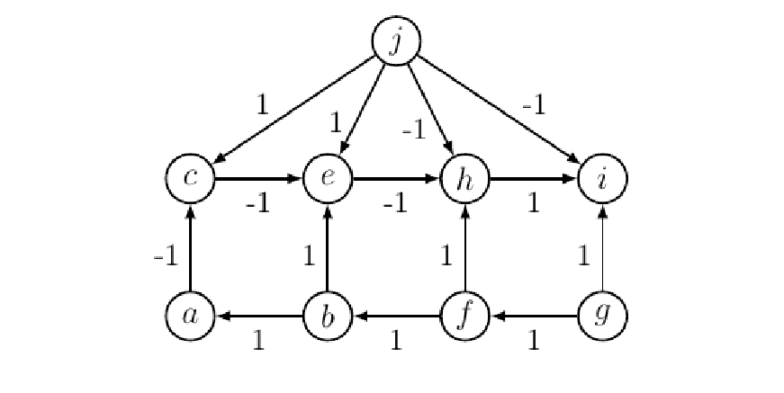 [One or more correct answers.]

- [incorrect] Dijkstra
- [correct] Bellman-Ford
- [correct] DAG-Shortest-Paths
- [incorrect] Kruskal
- [incorrect] Breadth-First-Search
- [incorrect] Depth-First-Search
- [correct] Floyd-Warshall
- [incorrect] Prim

## Question 24:
Which of the following subsets of nodes will make the tree a valid red-black tree, if exactly this subset of nodes is colored red (and the rest black)? 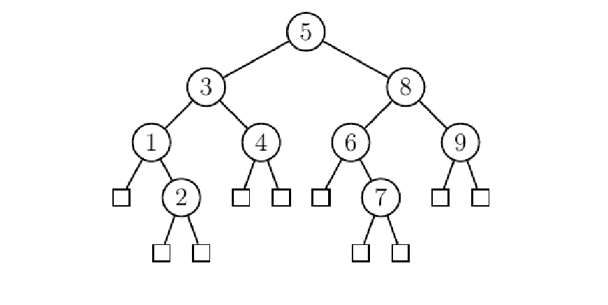 [One or more correct answers.]

- [correct] $2, 7$
- [incorrect] $1, 2, 4, 7, 8$
- [incorrect] $2, 5, 7$
- [incorrect] $2, 3, 6, 7, 9$
- [correct] $2, 3, 7, 8$

## Question 25:
> Insert key 10 into the following red-black tree (double circles indicate red nodes): 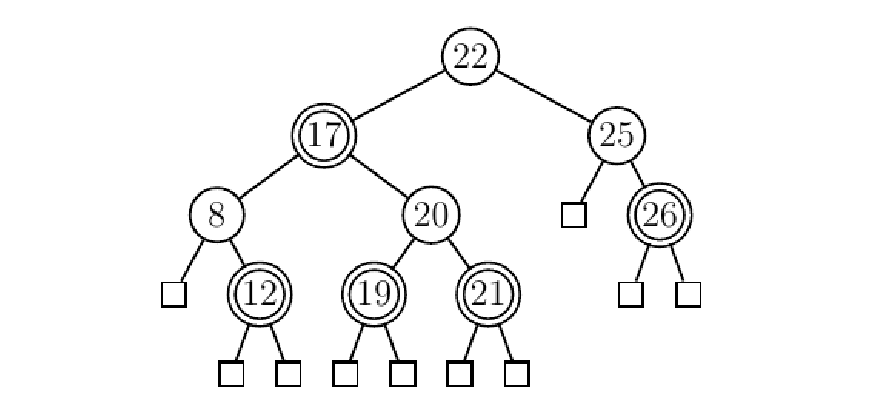

Which of the following shows the tree after the insertion?

- [ ] 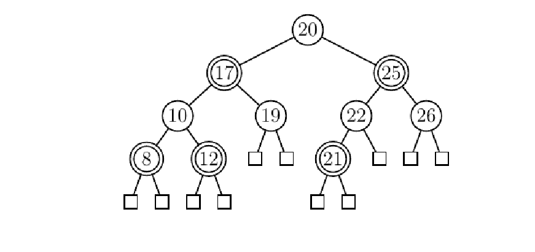
- [ ] 
- [ ] 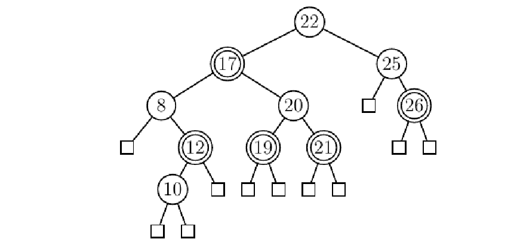
- [x] 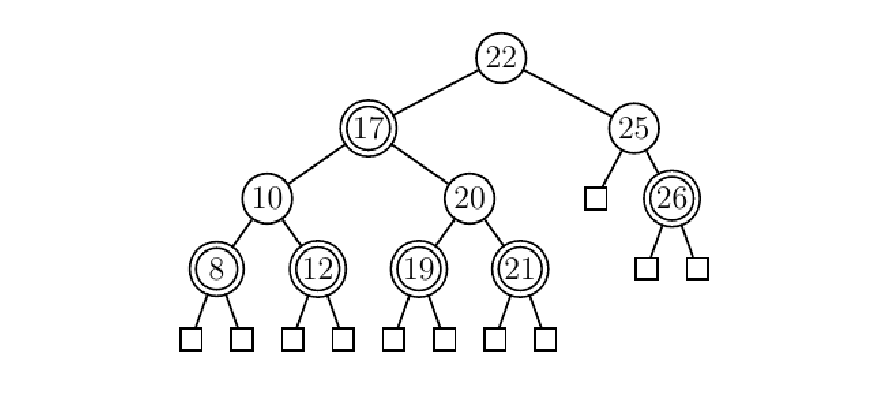

## Question 26:
> We consider the tree-based data structure for disjoint-sets (also called disjoint-set forest). Both heuristics union-by-rank and path compression are used. Method names refer to pseudo-code in Cormen et al., 4th edition.
>
> Starting from an empty structure, the following sequence of operations is performed:
>
> $\text{MAKE-SET}(a)$
> $\text{MAKE-SET}(b)$
> $\text{MAKE-SET}(c)$
> $\text{MAKE-SET}(d)$
> $\text{MAKE-SET}(e)$
> $\text{MAKE-SET}(f)$
> $\text{UNION}(f, e)$
> $\text{UNION}(b, f)$
> $\text{UNION}(d, a)$
> $\text{UNION}(f, d)$
> $\text{UNION}(b, c)$
> $\text{FIND-SET}(a)$

Which of the following figures shows the data structure after this sequence?

- [x] 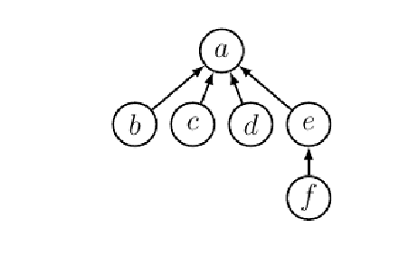
  > Union by rank keeps $a$ as the root, and the FIND-SET inside UNION$(b, c)$ moves $b$ straight under $a$.
- [ ] 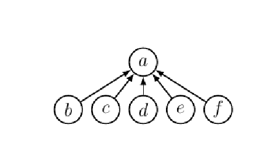
- [ ] 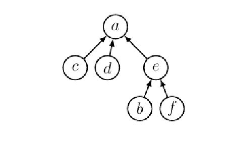
- [ ] 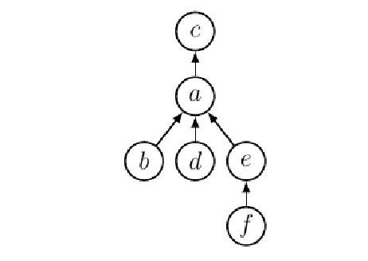

## Question 27:
> For the following algorithm, what is the asymptotic running time in $\Theta$-notation as a function of $n$?
>
> Code:
> ```
> ALGORITME1(n)
>   s = 0
>   while s < n
>     s = s + 3
> ```

What is the asymptotic running time in $\Theta$-notation as a function of $n$?

- [ ] $\Theta(\log n)$
- [ ] $\Theta(\sqrt{n})$
- [x] $\Theta(n)$
- [ ] $\Theta(n \log n)$
- [ ] $\Theta(n^2)$
- [ ] $\Theta(n^3)$

## Question 28:
> For the following algorithm, what is the asymptotic running time in $\Theta$-notation as a function of $n$?
>
> Code:
> ```
> ALGORITME2(n)
>   s = 0
>   i = 0
>   while i < n/2
>     for j = i to i + n/2
>       s = s + 1
>     i = i + 1
> ```

What is the asymptotic running time in $\Theta$-notation as a function of $n$?

- [ ] $\Theta(\log n)$
- [ ] $\Theta(\sqrt{n})$
- [ ] $\Theta(n)$
- [ ] $\Theta(n \log n)$
- [x] $\Theta(n^2)$
- [ ] $\Theta(n^3)$

## Question 29:
> For the following algorithm, what is the asymptotic running time in $\Theta$-notation as a function of $n$?
>
> Code:
> ```
> ALGORITME3(n)
>   i = 1
>   while i <= n
>     j = 1
>     while j <= n
>       j = j * 2
>     i = i + 2
> ```

What is the asymptotic running time in $\Theta$-notation as a function of $n$?

- [ ] $\Theta(\log n)$
- [ ] $\Theta(\sqrt{n})$
- [ ] $\Theta(n)$
- [ ] $\Theta(n \log n)$
- [x] $\Theta(n^2)$
- [ ] $\Theta(n^3)$

## Question 30:
> For the following algorithm, what is the asymptotic running time in $\Theta$-notation as a function of $n$?
>
> Code:
> ```
> ALGORITME4(n)
>   i = 1
>   j = n
>   while i <= j
>     i = i * 2
>     j = j / 2
> ```

What is the asymptotic running time in $\Theta$-notation as a function of $n$?

- [ ] $\Theta(\log n)$
- [ ] $\Theta(\sqrt{n})$
- [ ] $\Theta(n)$
- [ ] $\Theta(n \log n)$
- [x] $\Theta(n^2)$
- [ ] $\Theta(n^3)$

## Question 31:
> In this question we want to find the number $B(n)$ of binary trees with $n$ nodes. For example $B(3) = 5$, since there are five binary trees with three nodes.
>
> Based on a case analysis of the sizes of the root's two subtrees, one can show the following recurrence for $B(n)$:
>
> $$B(n) = \begin{cases} 1 & \text{if } n = 0 \\ \sum_{i=0}^{n-1} B(i) \cdot B(n - i - 1) & \text{if } n > 0 \end{cases}$$
>
> If $B(n)$ is found via dynamic programming based on this recurrence, what running time is achieved?

If $B(n)$ is found via dynamic programming based on this recurrence, what running time is achieved?

- [ ] $\Theta(1)$
- [ ] $\Theta(\log n)$
- [ ] $\Theta(n)$
- [ ] $\Theta(n \log n)$
- [x] $\Theta(n^2)$
- [ ] $\Theta(n^3)$

## Question 32:
> We still consider finding the number $B(n)$ of binary trees with $n$ nodes using the following recurrence:
>
> $$B(n) = \begin{cases} 1 & \text{if } n = 0 \\ \sum_{i=0}^{n-1} B(i) \cdot B(n - i - 1) & \text{if } n > 0 \end{cases}$$
>
> If $B(n)$ is found via dynamic programming based on this recurrence, what is the minimum space usage that can be achieved?

If $B(n)$ is found via dynamic programming based on this recurrence, what is the minimum space usage that can be achieved?

- [ ] $\Theta(1)$
- [ ] $\Theta(\log n)$
- [x] $\Theta(n)$
- [ ] $\Theta(n \log n)$
- [ ] $\Theta(n^2)$
- [ ] $\Theta(n^3)$
