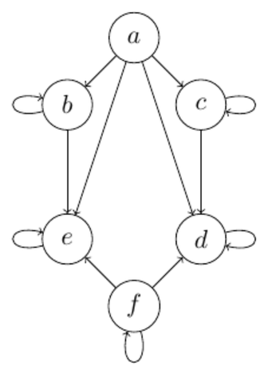

# Exam January 2025

## Question 1: Propositional logic
Let $p$, $q$, and $r$ be propositions. Which of the following statements are true?

- [true] If $p$ is false, then $p \oplus p$ is also false.
  > $p \oplus p$ is false for every $p$. (The Danish version of the paper reads $p \oplus q$, which would make the statement false: with $p$ false, $p \oplus q$ has the value of $q$.)
- [false] If $p$ is false and $q$ is true, then $p \lor (p \lor q)$ is false.
  > $\mathrm{F} \lor (\mathrm{F} \lor \mathrm{T}) = \mathrm{T}$.
- [false] The truth table for $p \land q$ has 2 rows.
  > Two variables give $2^2 = 4$ rows.
- [true] The truth table for $(p \land \lnot q) \lor r$ has 8 rows.
  > Three variables give $2^3 = 8$ rows.
- [false] The propositions $(p \land q) \Rightarrow q$ and $p \lor q$ are logically equivalent.
  > $(p \land q) \Rightarrow q$ is a tautology, but $p \lor q$ is false when $p$ and $q$ are both false.
- [false] The propositions $(p \lor q) \land \lnot q$ and $(\lnot q \land p) \lor p$ are logically equivalent.
  > The first simplifies to $p \land \lnot q$, the second to $p$ (absorption); they differ when $p$ and $q$ are both true.
- [true] There are propositions that are neither tautologies nor contradictions.
  > For example $p$ itself, which is true in some rows and false in others.
- [false] The proposition $(p \oplus q) \lor (p \lor q)$ is a tautology.
  > It is false when $p$ and $q$ are both false.
- [true] The proposition $(p \oplus q) \land (p \land q)$ is a contradiction.
  > $p \oplus q$ needs exactly one of them true, $p \land q$ needs both: never at the same time.

## Question 2: Quantifiers
Which of the following propositions are true?

- [false] $\exists x \in \mathbb{Z} : \forall y \in \mathbb{Z} : x \neq y$
  > Whatever $x$ is chosen, $y = x$ breaks it.
- [true] $\forall x \in \mathbb{Z}^+ : \exists y \in \mathbb{Z} : x + y = 2$
  > Take $y = 2 - x$.
- [true] $\exists x \in \mathbb{Z} : x^2 = 9$
  > $x = 3$ (or $x = -3$).
- [true] $\forall x, y \in \mathbb{Z} : x - y = -(y - x)$
  > $-(y - x) = x - y$ by ordinary algebra.
- [false] $\exists x \in \mathbb{Z}^+ : \forall y, z \in \mathbb{Z} : y - z \le x$
  > $y - z$ is unbounded: for any $x$, take $y = x + 1$ and $z = 0$.
- [true] $\forall x \in \mathbb{Z} : \exists y \in \mathbb{Z} : \forall z \in \mathbb{Z}^+ : x + y < z$
  > Take $y = -x$: then $x + y = 0 < z$ for every positive $z$.

## Question 3: Sets
Which of the following statements are true?

- [false] $|\{1, 5, 6\} \cup \{1\}| = 4$
  > The union is $\{1, 5, 6\}$, which has 3 elements.
- [true] $|\{2, 4, 5, 6\} \cap \{1, 4, 6\}| = 2$
  > The intersection is $\{4, 6\}$.
- [true] $\{1, 3, 5, 6\} \setminus \{1, 4, 5, 6\} = \{3\}$
  > 3 is the only element of the first set that is not in the second.
- [true] $\{1, 2\} \times \emptyset = \emptyset$
  > A pair would need a second coordinate from $\emptyset$, so there are none.
- [true] $\{n \in \mathbb{Z} \mid n/2 = 100\} \subset \{n \in \mathbb{Z} \mid n/100 \in \mathbb{Z}\}$
  > The left set is $\{200\}$, and 200 is a multiple of 100.
- [false] For all sets $A$, $B$, and $C$ with $A \subseteq C$ and $B \subseteq C$, we have $A \cap B \neq \emptyset$.
  > Counterexample: $A = B = \emptyset$, or any two disjoint subsets of $C$.
- [true] For any set $S$ with $\emptyset \in S$, it holds that $S \neq \emptyset$.
  > $S$ has at least one element, namely $\emptyset$.
- [false] The set $\{n \in \mathbb{Z} \mid n \le 5\}$ is finite.
  > It contains every negative integer.
- [true] The set $\{1, 2, 3\} \times \mathbb{Z}$ is countably infinite.
  > It is the union of three copies of the countable set $\mathbb{Z}$.
- [false] Every proper subset of $\mathbb{R}$ has cardinality $\aleph_0$.
  > $\mathbb{R} \setminus \{0\}$ is a proper subset and still uncountable (and $\emptyset$ is finite).

## Question 4: Functions
Consider the following two functions:
$$f : \mathbb{Z} \to \mathbb{Z},\ f(x) = x + 2, \qquad g : \mathbb{Z} \to \mathbb{Z},\ g(x) = x^2.$$
Which of the following statements are correct?

- [true] The image of $f$ is $\mathbb{Z}$.
  > Every $y \in \mathbb{Z}$ is hit by $x = y - 2$.
- [true] It holds that $(f \circ f)(x) = x + 4$ for all $x \in \mathbb{Z}$.
  > $f(f(x)) = (x + 2) + 2$.
- [false] It holds that $(f \circ g)(x) = (g \circ f)(x)$ for all $x \in \mathbb{Z}$.
  > $(f \circ g)(x) = x^2 + 2$ but $(g \circ f)(x) = (x + 2)^2$; at $x = 0$ they give 2 and 4.
- [true] The function $f$ is bijective.
  > Its inverse is $x \mapsto x - 2$.
- [false] The function $g$ is increasing.
  > $g(-1) = 1 > 0 = g(0)$.
- [false] The function $g$ is surjective.
  > Negative numbers and non-squares such as 2 are never hit.
- [false] The function $(f + g)(x)$ is defined and increasing.
  > It is defined, $(f + g)(x) = x^2 + x + 2$, but $(f + g)(-2) = 4 > 2 = (f + g)(-1)$.
- [false] The function $g^{-1}(x)$ is defined and strictly decreasing.
  > $g$ is not a bijection ($g(-1) = g(1)$), so it has no inverse.

## Question 5: Sequences
Consider the sequence $\{a_n\}$ defined by:
$$a_1 = 1, \qquad a_2 = 2, \qquad a_n = \frac{a_{n-1}}{a_{n-2}} \text{ for } n > 2.$$
Which of the below statements are true?

- [false] $a_3 = \frac{1}{2}$
  > $a_3 = a_2 / a_1 = 2$.
- [true] $a_5 = \frac{1}{2}$
  > The sequence runs $1, 2, 2, 1, \tfrac{1}{2}, \tfrac{1}{2}, 1, 2, \dots$
- [false] There exists an $n \in \mathbb{Z}^+$ such that $a_n = \frac{1}{4}$.
  > The sequence repeats with period 6 and only takes the values $1$, $2$ and $\tfrac{1}{2}$.
- [true] There are infinitely many $n \in \mathbb{Z}^+$ such that $a_n = 1$.
  > The sequence has period 6, so $a_n = 1$ for $n = 1, 4, 7, 10, \dots$

## Question 6: Induction proofs
Consider the sequence $\{a_n\}$ defined by:
$$a_0 = 1, \qquad a_n = 2a_{n-1} + 2 \text{ for } n \ge 1.$$
Which of the following options constitute correct proofs for the following statement?
$$a_n = 3 \cdot 2^n - 2, \text{ for } n \ge 0.$$

- [true] We use induction on $n$ to prove the equivalent statement $a_n = 2^{n+1} + 2^n - 2$, for $n \ge 0$.
  **Basis:** For $n = 0$, we have $a_0 = 1 = 2^1 + 2^0 - 2$.
  **Induction step:** For $n \ge 1$, we have
  $$\begin{aligned} a_n &= 2a_{n-1} + 2 && \text{(by the definition of } a_n\text{)} \\ &= 2 \cdot (2^n + 2^{n-1} - 2) + 2 && \text{(by the induction hypothesis)} \\ &= 2^{n+1} + 2^n - 4 + 2 \\ &= 2^{n+1} + 2^n - 2. \end{aligned}$$
  > Valid: $2^{n+1} + 2^n = 3 \cdot 2^n$, so the statement really is equivalent, and every step is justified.
- [true] We use induction on $n$ to prove $a_n = 3 \cdot 2^n - 2$, for $n \ge 0$.
  **Basis:** For $n = 0$, we have $a_0 = 1 = 3 \cdot 2^0 - 2$.
  **Induction step:** For $n \ge 1$, we have
  $$\begin{aligned} a_n &= 2a_{n-1} + 2 && \text{(by the definition of } a_n\text{)} \\ &= 2 \cdot (3 \cdot 2^{n-1} - 2) + 2 && \text{(by the induction hypothesis)} \\ &= 2 \cdot 3 \cdot 2^{n-1} - 4 + 2 \\ &= 3 \cdot 2^n - 2. \end{aligned}$$
  > A standard, complete induction proof.
- [true] We use strong induction on $n$ to prove $a_n = 3 \cdot 2^n - 2$, for $n \ge 0$.
  **Basis:** For $n = 0$ and $n = 1$, we have $a_0 = 1 = 3 \cdot 2^0 - 2$ and $a_1 = 4 = 3 \cdot 2^1 - 2$.
  **Induction step:** For $n \ge 2$, we have
  $$\begin{aligned} a_n &= 2a_{n-1} + 2 && \text{(by the definition of } a_n\text{)} \\ &= 2 \cdot (2a_{n-2} + 2) + 2 && \text{(by the definition of } a_{n-1}\text{)} \\ &= 2 \cdot (2 \cdot (3 \cdot 2^{n-2} - 2) + 2) + 2 && \text{(by the induction hypothesis)} \\ &= 2 \cdot (2 \cdot 3 \cdot 2^{n-2} - 4 + 2) + 2 \\ &= 2 \cdot (3 \cdot 2^{n-1} - 2) + 2 \\ &= 2 \cdot 3 \cdot 2^{n-1} - 4 + 2 \\ &= 3 \cdot 2^n - 2. \end{aligned}$$
  > Valid: for $n \ge 2$ the recurrence applies to $a_{n-1}$, strong induction covers $a_{n-2}$, and both base cases are checked.
- [false] We use induction on $n$ to prove $a_n = 3 \cdot 2^n - 2$, for $n \ge 0$.
  **Basis:** For $n = 0$, we have $a_0 = 1 = 3 \cdot 2^0 - 2$.
  **Induction step:** For $n \ge 1$, we have
  $$\begin{aligned} a_n &= 2a_{n-1} + 2 && \text{(by the definition of } a_n\text{)} \\ &= 2 \cdot (2a_{n-2} + 2) + 2 && \text{(by the definition of } a_{n-1}\text{)} \\ &= 2 \cdot (2 \cdot (3 \cdot 2^{n-2} - 2) + 2) + 2 && \text{(by the induction hypothesis)} \\ &= 2 \cdot (2 \cdot 3 \cdot 2^{n-2} - 4 + 2) + 2 \\ &= 2 \cdot (3 \cdot 2^{n-1} - 2) + 2 \\ &= 2 \cdot 3 \cdot 2^{n-1} - 4 + 2 \\ &= 3 \cdot 2^n - 2. \end{aligned}$$
  > Broken at $n = 1$: $a_0$ is not given by the recurrence, so there is no $a_{-1}$ to expand it into. The step also uses the claim for $n - 2$, which ordinary induction does not assume.

## Question 7: Relations
Consider the below graph representing the relation $R$. Which of the following statements are true?

- [true] The matrix representation of $R$ has precisely six rows and six columns.
  > $R$ is a relation on the six vertices $\{a, b, c, d, e, f\}$, so its matrix is $6 \times 6$.
- [false] The set representation of $R$ has precisely six elements.
  > $R$ has 13 pairs: 8 edges between distinct vertices plus 5 loops.
- [false] $R$ is reflexive.
  > $a$ has no loop, so $(a, a) \notin R$.
- [false] $R$ is irreflexive.
  > $b$, $c$, $d$, $e$ and $f$ have loops.
- [false] $R$ is symmetric.
  > $(a, b) \in R$ but $(b, a) \notin R$.
- [true] $R$ is antisymmetric.
  > No two distinct vertices have edges in both directions.
- [true] $R$ is transitive.
  > Every two-step path has a direct edge: $a \to b \to e$ has $a \to e$, $a \to c \to d$ has $a \to d$, and every other two-step path goes through a loop.
- [true] $R \circ R = R$
  > $R$ is transitive, so $R \circ R \subseteq R$. Conversely, every pair in $R$ is also a two-step path, because it ends at a vertex with a loop (for example $a \to b \to b$).

## Question 8: Properties of relations
Let $A = \{a, b, c\}$. Which of the following statements are true?

- [true] There is no relation on $A$ that is both reflexive and irreflexive.
  > Reflexive needs $(a, a) \in R$ and irreflexive forbids it; since $A$ is non-empty, both cannot hold.
- [false] There is no relation on $A$ that is both symmetric and antisymmetric.
  > The identity relation $\{(a, a), (b, b), (c, c)\}$ (or $\emptyset$) is both.
- [true] For any relation $R$ on $A$, if $R$ is an equivalence relation, then $R$ is the transitive closure of $R$.
  > An equivalence relation is already transitive, so taking the transitive closure adds nothing.
- [false] For any relation $R$ on $A$ that is a partial order, $R$ has at least as many greatest elements as it has maximal elements.
  > Under the identity relation, $a$, $b$ and $c$ are all maximal but none is greatest. A greatest element is always the unique maximal one, so the inequality goes the other way.

## Question 9: Divisibility, gcd and lcm
Which of the following statements are true for all $a, b, c \in \mathbb{Z}^+$?
(Recall that gcd means greatest common divisor and lcm means least common multiple.)

- [false] $(a \mid b) \land (b \mid c) \Rightarrow ((a + b) \mid c)$
  > Counterexample: $a = 1$ and $b = c = 2$; then $3 \nmid 2$.
- [true] $(a \mid b) \land (b \mid c) \Rightarrow (a \mid (b - c))$
  > $a \mid b$ and, by transitivity, $a \mid c$, so $a$ divides their difference.
- [true] $\gcd(12, 18) = 6$
  > $12 = 2^2 \cdot 3$ and $18 = 2 \cdot 3^2$ share $2 \cdot 3$.
- [false] $\gcd(12, 42) = 3$
  > $\gcd(12, 42) = 6$.
- [false] $\operatorname{lcm}(4, 6) = 24$
  > $\operatorname{lcm}(4, 6) = 12$.
- [true] $\operatorname{lcm}(12, 32) = 96$
  > $12 = 2^2 \cdot 3$ and $32 = 2^5$, so the lcm is $2^5 \cdot 3 = 96$.
- [true] 12 and 35 are relatively prime.
  > $12 = 2^2 \cdot 3$ and $35 = 5 \cdot 7$ share no prime factor.

## Question 10: Congruences
Which of the following statements are true?

- [true] $3 \equiv 31 \pmod{4}$
  > $31 - 3 = 28 = 4 \cdot 7$.
- [true] For all $a, b \in \mathbb{Z}$, if $a \equiv b \pmod{3}$, then $7a \equiv b \pmod{3}$.
  > $7 \equiv 1 \pmod{3}$, so $7a \equiv a \equiv b$.
- [false] For all $a, b \in \mathbb{Z}$, $35a \equiv 5b \pmod{10}$ if and only if $7a \equiv b \pmod{10}$.
  > $35a \equiv 5b \pmod{10}$ only says $7a \equiv b \pmod{2}$. Counterexample: $a = 0$, $b = 2$.
- [true] For all $a, b \in \mathbb{Z}$, if $4 \equiv a \pmod{9}$ and $7 \equiv b \pmod{9}$, then $11 \equiv a + b \pmod{9}$.
  > Congruences can be added: $a + b \equiv 4 + 7 = 11 \pmod{9}$.
- [false] For all $a, b \in \mathbb{Z}$, if $a \equiv 4 \pmod{10}$ and $b \equiv 3 \pmod{5}$, then $a + b \equiv 7 \pmod{15}$.
  > Counterexample: $a = 4$ and $b = 8$ give $a + b = 12 \not\equiv 7 \pmod{15}$.
- [true] For all $a, b \in \mathbb{Z}$ and $c \in \mathbb{Z}^+$, if $a \bmod c = b \bmod c$, then there exists an integer $k$ such that $a = b + kc$.
  > Equal remainders mean $c \mid a - b$, i.e. $a - b = kc$ for some integer $k$.

## Question 11: Systems of congruences
Which statements about the following system of congruences are true?
$$\begin{aligned} x &\equiv a_1 \pmod{m_1} \\ x &\equiv a_2 \pmod{m_2} \end{aligned}$$

- [true] If $a_1 = 5$, $a_2 = 10$, and $m_1 = m_2 = 10$, then there is no solution to the system in $\mathbb{Z}$.
  > $x$ would have to leave remainder 5 and remainder 0 when divided by 10.
- [false] If $a_1 = 3$, $a_2 = 7$, $m_1 = 2$, and $m_2 = 5$, then $x = 12$ is a solution to the system.
  > $12 \equiv 7 \pmod{5}$, but $12 \not\equiv 3 \pmod{2}$ since 12 is even.
- [false] There are $a_1, a_2 \in \mathbb{Z}$ and integers $m_1, m_2 \ge 2$ such that the system has precisely 17 solutions in $\mathbb{Z}$.
  > The solutions are either none or a whole residue class modulo $\operatorname{lcm}(m_1, m_2)$, which is infinite.
- [false] For all $a_1, a_2 \in \mathbb{Z}$ that are relatively prime and all $m_1, m_2 \ge 2$ that are integers, the system has at least one solution.
  > Solvability depends on the moduli, not on $a_1, a_2$ being coprime. Counterexample: $a_1 = 1$, $a_2 = 2$, $m_1 = m_2 = 2$ asks for an $x$ that is both odd and even.

## Question 12: Sums
Which of these statements are true?

- [false] $8\sum_{k=1}^{10} k = 80$
  > $\sum_{k=1}^{10} k = 55$, so the left side is 440.
- [false] $\sum_{i=1}^{10} i^2 = \left(\sum_{i=1}^{10} i\right)^2$
  > $385 \neq 55^2 = 3025$.
- [true] For all $n \in \mathbb{Z}^+$, we have $\sum_{i=1}^{n} 8i = 8\sum_{i=1}^{n} i$.
  > A constant factor can be pulled out of a sum.
- [true] For all $n \in \mathbb{Z}^+$, we have $\sum_{i=1}^{n} \left(\frac{4}{5}\right)^i = 4 - \frac{4^{n+1}}{5^n}$.
  > Geometric series: $\frac{4}{5} \cdot \frac{1 - (4/5)^n}{1 - 4/5} = 4\left(1 - \frac{4^n}{5^n}\right) = 4 - \frac{4^{n+1}}{5^n}$.

## Question 13: Matrices
This question concerns the matrices $A$ and $B$ as defined below and their products $C = A \cdot B$ and $D = B \cdot A$.
$$A = \begin{bmatrix} 1 & 2 \\ 3 & 4 \\ 5 & 6 \end{bmatrix} \qquad B = \begin{bmatrix} 1 & 2 & 3 \\ 1 & 2 & 3 \end{bmatrix}$$

- [true] $A$ has a transpose.
  > Every matrix has a transpose; $A^T$ is $2 \times 3$.
- [false] There is an $n \in \mathbb{Z}^+$ such that $A$ is the identity matrix of order $n$.
  > $A$ is not even square.
- [false] $B$ is symmetric.
  > Only square matrices can be symmetric, and $B$ is $2 \times 3$.
- [false] $C$ is a $2 \times 2$ matrix.
  > A $3 \times 2$ times a $2 \times 3$ matrix is $3 \times 3$.
- [false] The entry in the topmost row and leftmost column of $D$ is 2.
  > $d_{11} = 1 \cdot 1 + 2 \cdot 3 + 3 \cdot 5 = 22$.
- [true] The product $C \cdot D$ is not defined.
  > $C$ is $3 \times 3$ and $D$ is $2 \times 2$, so the inner dimensions do not match.

## Question 14: Permutations and combinations
Which of these statements are true?

- [true] $P(5, 2) = 20$
  > $5 \cdot 4 = 20$.
- [false] $P(25, 2) = 100$
  > $25 \cdot 24 = 600$.
- [true] $C(27, 5) = \binom{27}{22}$
  > $C(n, k) = C(n, n - k)$.
- [true] $C(7, 3) + C(7, 2) = C(8, 3)$
  > Pascal's identity: $35 + 21 = 56$.
- [false] For all $k, n \in \mathbb{Z}^+$ with $k \le n$, we have $P(n, k) \cdot (n - k + 1)! = n!$.
  > $P(n, k) = \frac{n!}{(n - k)!}$, so the product is $n! \cdot (n - k + 1)$, which equals $n!$ only when $k = n$. It would hold with $(n - k)!$.
- [false] For all $m \in \mathbb{Z}^+$, we have $P(m, m) = m^2$.
  > $P(m, m) = m!$; already $P(2, 2) = 2 \neq 4$.
- [true] For all $m \in \mathbb{Z}^+$, the sum of entries in the $m$-th row of Pascal's Triangle is larger than the sum of *all* entries of rows $1, \ldots, m - 1$.
  > Row sums are powers of two, and each exceeds the sum of all smaller ones: $2^k > 2^{k-1} + \dots + 2 + 1$. This holds whichever row you count from.
- [false] For all $n \in \mathbb{Z}^+$, we have $\sum_{i=0}^{n} P(n, i) = 2^n$.
  > That identity holds for $C(n, i)$. With permutations, $n = 2$ gives $1 + 2 + 2 = 5 \neq 4$.

## Question 15: Counting
Which of the below statements are true?

- [true] The number of different strings of length 8 where the first symbol is the digit 0 and the rest are lower-case English letters is $26^7$.
  > The first symbol is fixed, and each of the other 7 positions has 26 choices.
- [true] After expanding $(x + y)^{2025}$, the coefficient of $xy^{2024}$ is 2025.
  > Binomial theorem: $\binom{2025}{1} = 2025$.
- [true] There are precisely 10 different subsets of $\{1, 2, \ldots, 10\}$ of cardinality 9.
  > $\binom{10}{9} = 10$: choose the one element to leave out.
- [true] There are precisely $C(9, 7)$ ways of choosing the integers $x_1, x_2, x_3 \ge 0$ such that $x_1 + x_2 + x_3 = 7$.
  > Stars and bars: $C(7 + 3 - 1, 7) = C(9, 7) = 36$.
- [false] The letters of the string COUNTING can be arranged into precisely $8!$ different strings (where all letters are used).
  > N appears twice, so there are $8!/2! = 20160$ arrangements.
- [false] For all $m \in \mathbb{Z}^+$, there are as many ways of distributing $m^2$ distinguishable books into 2 indistinguishable boxes as there are $m \times m$ zero-one matrices.
  > There are $2^{m^2}$ zero-one matrices but only $2^{m^2 - 1}$ distributions, because swapping the two indistinguishable boxes gives the same distribution.
- [true] There are twice as many bitstrings of length 1001 as there are bitstrings of length 1000.
  > $2^{1001} = 2 \cdot 2^{1000}$.
- [false] For all $m, n \in \mathbb{Z}^+$ with $m \le n$, there are precisely $C(n, m)$ injective functions $f : \{1, \ldots, m\} \to \{1, \ldots, n\}$.
  > There are $P(n, m)$ of them, since the order of the images matters; for example $m = n = 2$ gives 2, not 1.
