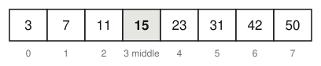

## Question 3
> Binary search looks for 23 in this array:
>
> 

Why does binary search only work on a sorted array?

### Answer
Each step compares the key with the middle element and drops the half that cannot contain it. Here 23 is bigger than 15, so only the right half is searched. That is only safe when the elements are in order.
